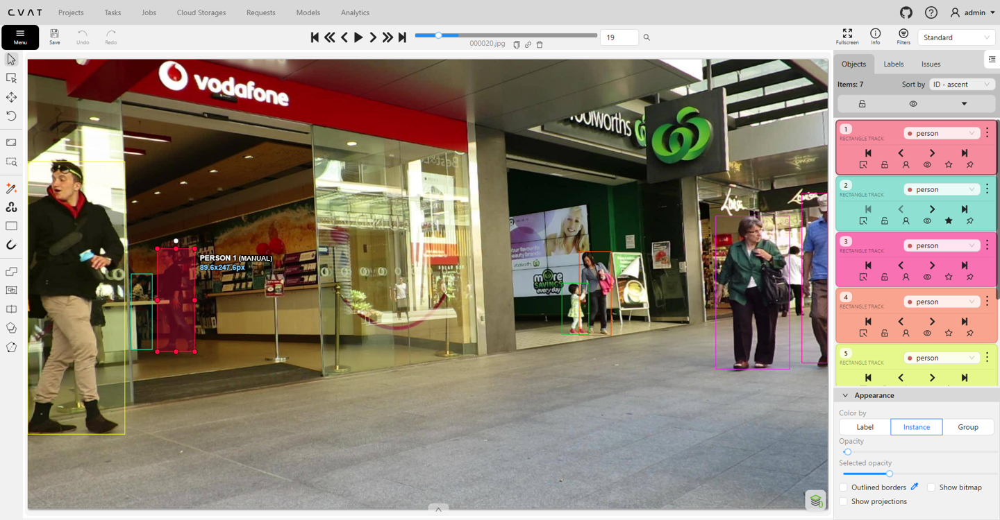
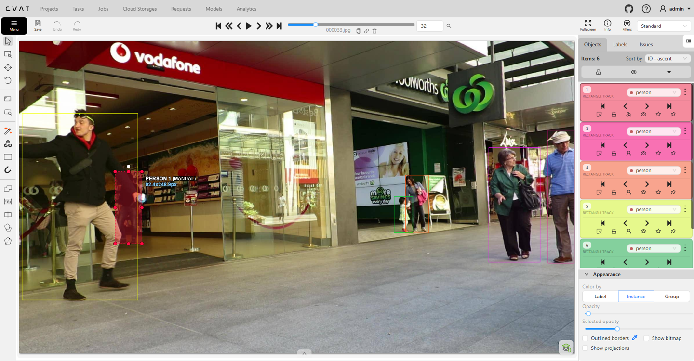
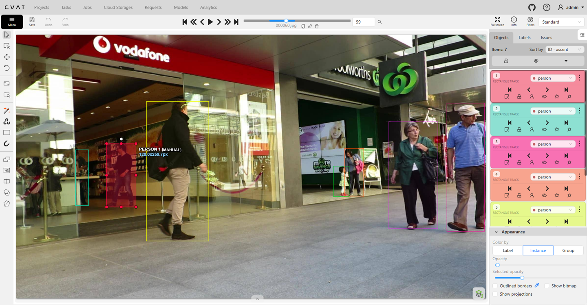

# Báo cáo cá nhân — HoNgocTrung-2A202604041

Đoạn video: MOT17-09, 150 frame (frame 1–150), nguồn MOTChallenge, giấy phép CC BY-NC-SA 3.0.

> Số frame trong báo cáo ghi **theo CVAT (0–149)**. Trong `gt.txt`, `frame_id` = frame CVAT + 1.

## 0. Thông tin học viên

- Họ tên: Hồ Ngọc Trung
- MSSV: 2A202604041
- Mã đề (A/B/C): **C**
- Email: hongoctrung1120@gmail.com
- Link repository: https://github.com/hongoctrung1120/K5-L2-DAY05-HoNgocTrung-2A202604041-MOTTracking
- Giờ bắt đầu: 16:45
- Giờ kết thúc: 19:20

## 1. Xem trước đoạn video (CP0)

| Mã | Frame xuất hiện | Frame cuối thấy được | Rẽ / dừng / đổi tốc độ ở frame | Bị che ở frame | Ghi chú |
|---|---|---|---|---|---|
| P1 | 0 | 149 | Đi bộ chậm bên trong cửa hàng khoảng 0–36; sau khi lộ diện lại ở frame 50 thì tiếp tục đi sang phải và tiến dần ra phía cửa kính đến 149 | Bị P5 đi ngang che một phần ở 26–36, che khuất hoàn toàn ở 37–49, che một phần ở 50–56 | Nam mặc áo đen, quần jean, đi bên trong cửa hàng Vodafone (đối tượng xét chính ở CP2) |
| P2 | 19 | 149 | Đứng gần như tại chỗ ở 19–63; từ khoảng 69 bắt đầu bước sang phải và tiến lại gần phía cửa kính từ 89–149 | Bị P5 che một phần ở 22–28, che hoàn toàn ở 29–40, che một phần ở 41–44; cuối đoạn (148–149) bị người áo xanh nhạt đi ngang che một phần | Nữ mặc áo sáng màu đứng sau lớp kính bên trái cửa hàng Vodafone |
| P3 | 0 (một phần ở mép phải) | 149 | Đi thẳng về phía camera và lệch dần sang trái; càng về cuối kích thước người trên hình càng lớn nhanh | Không bị che khuất | Ông đội mũ trắng, áo sơ mi xanh kẻ sọc, đi song song rất sát bà mặc áo khoác xanh lá |
| P4 | 0 | 104 | Nhích nhẹ sang phải ở 0–24 rồi đứng lại trước cửa hàng Woolworths | Bị bé gái và bà áo khoác xanh lá đi tới che một phần từ 89–104; khuất hẳn từ frame 105 đến hết video | Phụ nữ đeo túi hồng đứng nắm tay bé gái trước cửa Woolworths |
| P5 | 0 (một phần ở mép trái) | 132 | Đứng ở tiền cảnh trái, xoay người và dang rộng tay ở 0–45; khoảng frame 47 xoay lưng lại và bước đi sang phải, xa dần camera | Bị bà áo khoác xanh lá che một phần ở 110–117, khuất hẳn 118–128; lộ lại một phần ở khe giữa bà áo xanh lá và P3 tại 129–132 rồi khuất hẳn từ 133 | Nam mặc áo khoác đen, quần kaki ở tiền cảnh bên trái |

## 2. Keyframe và thời gian (CP1, CP4)

Số keyframe lấy từ kết quả chạy `src/check_submission.py`. Thứ tự track trên CVAT: Track 0 = P1, Track 1 = P2, Track 2 = P3, Track 3 = P4, Track 4 = P5.

| Mã | Số keyframe | Keyframe ở frame | Số frame có mặt | Keyframe / 100 frame | Thời gian (phút) | Chỗ khó |
|---|---:|---|---:|---:|---:|---|
| P1 | 15 | 0, 13, 18, 26, 36, 50, 57, 68, 75, 83, 89, 95, 103, 133, 149 | 137 | 10,9 | 12 | Bị P5 chắn ngang làm khuất hoàn toàn 13 frame; bên trong cửa hàng hơi tối và có nhân viên đứng sau quầy gần đó nên dễ kéo nhầm |
| P2 | 11 | 19, 22, 28, 41, 45, 63, 69, 89, 111, 148, 149 | 119 | 9,2 | 10 | Người ở khá xa phía sau cửa kính phản chiếu bóng, lúc mới xuất hiện ở frame 19–28 đã bị P5 tiến vào che dần |
| P3 | 11 | 0, 7, 21, 55, 91, 100, 119, 125, 129, 139, 149 | 150 | 7,3 | 9 | Tiến lại gần camera nên chiều cao box tăng rất nhanh ở nửa cuối video; đi sát bà áo khoác xanh lá nên phải căn kỹ mép trái của box |
| P4 | 5 | 0, 24, 45, 89, 104 | 105 | 4,8 | 6 | Đứng yên nên tốn ít keyframe, nhưng đoạn cuối bị bà áo xanh lá đi qua che dần nên cần tua từng frame để chốt đúng mốc khuất hẳn (frame 105) |
| P5 | 19 | 0, 20, 37, 47, 53, 57, 62, 68, 74, 80, 86, 93, 99, 105, 110, 114, 117, 129, 132 | 122 | 15,6 | 15 | Vung tay rộng ở đầu video làm bề ngang box thay đổi mạnh, sau đó đổi hướng đi xa dần và bị che khuất 2 lần ở cuối đoạn |
| **Tổng** | **61** | | **633** | **9,6** | **52** | |

Tỉ lệ keyframe của 5 người chính = 61 ÷ 633 × 100 ≈ **9,6 keyframe / 100 frame** (tính cả 2 track làm thêm ở phần Bonus B1 là 82 ÷ 895 × 100 ≈ **9,2 keyframe / 100 frame**).

**Bạn đặt keyframe nhiều nhất ở người nào? Vì sao?**

Tôi đặt nhiều keyframe nhất ở **P5 (19 keyframe)**. Lý do là chuyển động và hình dáng hộp bao của P5 thay đổi liên tục qua 3 giai đoạn:
1. Ở đoạn đầu (frame 0–45), P5 đứng ở tiền cảnh xoay người và vung rộng hai cánh tay rồi lại hạ tay xuống. Vì nội suy tuyến tính chỉ cho phép kích thước box tăng/giảm đều giữa hai mốc, nếu đặt thưa keyframe thì hộp bao sẽ bị hụt mất phần cánh tay lúc dang rộng hoặc bị dư khoảng trống lớn lúc khép tay.
2. Từ khoảng frame 47, P5 xoay người bước đi sang phải và tiến ra xa camera. Lúc này vị trí lẫn chiều cao, chiều rộng theo nhịp sải chân thay đổi liên tục nên tôi phải đặt keyframe dày hơn (khoảng 5–7 frame một lần) để box không bị lệch khỏi người.
3. Cuối đoạn (từ frame 110 trở đi), P5 đi vào sau lưng bà áo khoác xanh lá và ông P3, bị che khuất hoàn toàn rồi lộ ra lại một khoảng ngắn (129–132) trước khi mất hẳn, nên cần cắm các keyframe sát mốc bắt đầu che, mốc `outside` và mốc hiện lại.

Ngược lại, P4 chỉ cần 5 keyframe vì người này đứng gần như cố định một chỗ trước cửa hàng Woolworths, nội suy tuyến tính giữ hộp bao khớp tốt trong suốt đoạn dài.

## 3. Đoạn bị che (CP2)

Đối tượng theo dõi: **P1** (nam mặc áo đen đi bên trong cửa hàng Vodafone), bị **P5** (nam mặc áo khoác đen ở tiền cảnh) đi ngang qua che khuất.

| Mốc | Frame |
|---|---:|
| Bắt đầu bị che một phần (bật `occluded`) | 26 |
| Mất hẳn (bật `outside`) | 37 |
| Hiện lại (tắt `outside`) | 50 |
| Thấy rõ trở lại (tắt `occluded`) | 57 |

- Thời gian khuất hẳn: **13 frame** (từ frame 37 đến hết frame 49), tương đương 13 / 30 ≈ **0,43 giây**.
- Quyết định: **Giữ cùng một track ID** (Track 1 trên giao diện CVAT / ID 1 trong `gt.txt`) trước và sau khi bị che.
- Lý do (theo 3 câu hỏi trong `docs/GUIDELINE.md`, mục 3):
  1. **Khuất bao lâu so với ngưỡng 60 frame?** P1 chỉ khuất hoàn toàn trong 13 frame (~0,43 giây), nhỏ hơn rất nhiều so với ngưỡng 60 frame (2 giây) của lớp.
  2. **Ngoại hình có khớp không?** Khớp hoàn toàn. Người lộ ra sau lưng P5 ở frame 50 vẫn là người đàn ông mặc áo thun đen dài tay, quần jean xanh, tóc ngắn đi bên trong cửa hàng Vodafone.
  3. **Chỗ hiện lại có đúng hướng đi và tốc độ cũ không?** Đúng. Trước khi bị P5 che (frame 0–36), P1 đang bước chậm từ trái sang phải bên trong cửa hàng. Khi hiện lại ở frame 50, vị trí của P1 nhích sang phải một đoạn ngắn vừa khớp với tốc độ đi bộ chậm trước đó.

Trong các đoạn bị che một phần (frame 26–36 và 50–56), tôi bật cờ `occluded` (`Q`) và vẫn giữ hộp bao **kích thước toàn thân ước lượng (amodal box)** từ đầu tới bàn chân, không co nhỏ hộp theo phần cơ thể nhìn thấy. Ở đoạn mất hẳn (frame 37–49), tôi bật cờ `outside` (`O`) nên trong file `gt.txt` không xuất hiện dòng dữ liệu nào của ID 1 ở các frame này (`frame_id` 38–50).

Ngoài P1, trong bài còn có P2 (khuất 12 frame từ 29–40 sau lưng P5) và P5 (khuất 11 frame từ 118–128 sau lưng bà áo khoác xanh lá). Cả hai trường hợp đều khuất dưới 60 frame, ngoại hình và quỹ đạo khi hiện lại đều khớp nên tôi đều dùng `outside` rồi tắt `outside` trên cùng track để giữ nguyên ID. Riêng P4 bị khuất hẳn từ frame 105 và không xuất hiện lại cho tới hết frame 149 nên tôi bật `outside` tại frame 105 để kết thúc track.

Ảnh chụp màn hình minh chứng (nguồn ảnh gốc: MOT17, MOTChallenge (Milan et al., 2016)):

**1. Trước khi bị che (Frame 19):** P1 (`PERSON 1 (MANUAL)`) đang đi bên trong cửa hàng Vodafone, chưa bị P5 chắn ngang.



**2. Giữa đoạn bị che (Frame 32):** P5 bước ngang qua trước mặt P1. Trên panel Objects bên phải, Track 1 đang bật biểu tượng `occluded`, viền box hiển thị nét đứt và vẫn giữ kích thước toàn thân ước lượng.



**3. Sau khi hiện lại (Frame 59):** P1 đã đi qua khỏi lưng P5, tắt `outside` và `occluded`, giữ nguyên định danh `PERSON 1 (MANUAL)` (cùng Track 1 như ban đầu).



## 4. Tự review ID (CP3)

Tôi thực hiện rà soát đủ 2 lượt: Lượt 1 lọc và đi ngược từng người từ frame 149 về 0 bằng phím `D`/`C`; Lượt 2 bật toàn bộ các track và nhảy mỗi bước 10 frame bằng phím `V` để quan sát tương quan cả cảnh.

| Frame | Mã người | Loại lỗi | Mô tả một câu | Phát hiện ở lượt | Đã sửa? |
|---:|---|---|---|:---:|---|
| 50 | P1 | `fragmentation` | Lúc mới gán, khi P1 hiện lại sau lưng P5 ở frame 50 tôi lỡ vẽ thành track mới thay vì nối tiếp track cũ | 1 | Có. Dùng Merge (`M`) gộp về Track 1 và bật `outside` ở 37–49 |
| 129 | P5 | `fragmentation` | P5 lộ ra lại ở khe giữa bà áo xanh lá và P3 trong 4 frame (129–132) bị tách thành một track rời | 1 | Có. Merge về cùng track P5, đặt `outside` ở 118–128 và từ 133 |
| 22–28 | P2 | `flag` | Đoạn P2 bắt đầu bị P5 che phần đầu bị quên bật cờ `occluded` và kéo đỉnh box hơi thấp | 1 | Có. Bật `occluded` từ frame 22 và kéo cạnh trên bao hết phần đầu ước lượng |
| 36 | P1 | `drift` | Box nội suy của P1 ngay trước khi khuất hoàn toàn bị trôi lệch nhẹ xuống dưới so với chân người | 1 | Có. Chỉnh lại vị trí keyframe tại frame 36 |
| 100–149 | P3 | `drift` | Khi P3 tiến sát camera ở cuối video, nội suy giữa các mốc thưa làm box nhỏ hơn người thật | 2 | Có. Chèn thêm các keyframe ở frame 100, 119, 129 và 139 |
| 112–149 | Bé gái (bonus B1) | `false_track` | Bé gái đã khuất hẳn sau lưng bà áo xanh lá từ frame 112 nhưng bấm nhầm `occluded` thay vì `outside` nên box đứng yên đè lên người khác | 2 | Có. Chuyển sang bật `outside` tại frame 112 (và bật `occluded` từ 105–111) |

Tổng hợp số lỗi đã phát hiện và xử lý theo loại:

| `id_switch` | `fragmentation` | `lost` | `merge` | `false_track` | `drift` | `flag` |
|---:|---:|---:|---:|---:|---:|---:|
| 0 | 2 | 0 | 0 | 1 | 2 | 1 |

**Lỗi nào chỉ lượt 2 (theo cảnh) mới thấy, lượt 1 (theo người) không thấy? Vì sao?**

Đó là lỗi **`drift` kích thước của P3 ở đoạn cuối (frame 100–149)** và lỗi **`false_track` của track bé gái (frame 112–149)**.

Khi rà soát ở lượt 1, tôi chỉ bật hiển thị từng người và lùi từng frame một. Vì giữa hai frame liên tiếp hình dáng box thay đổi rất nhỏ nên mắt quen dần, khó nhận ra box của P3 đang bị hụt dần so với tốc độ phóng to của người thật khi tiến gần ống kính; còn với track bé gái, do tập trung vào các người chính trước đó nên khi tua lẻ không để ý hộp bao vẫn nằm lại trên nền cảnh.

Sang lượt 2, khi bật tất cả các box và nhảy 10 frame một lần bằng phím `V`, mắt có sự đối chiếu trực tiếp giữa các đối tượng trong cùng khung hình: nhìn P3 đi cạnh bà áo khoác xanh lá thì thấy ngay hộp bao của P3 bị hụt so với tỷ lệ cơ thể hai người; đồng thời thấy rõ hộp bao của bé gái đang nằm đè lên chân bà áo khoác xanh lá dù bé gái đã bị che khuất hoàn toàn từ frame 112.

## 5. File xuất và kết quả tự kiểm (CP4)

| Kiểm tra | Kết quả |
|---|---|
| Tên file MOT 1.1 | `src/exports/HoNgocTrung_mot.zip` |
| Tên file CVAT for video 1.1 | `src/exports/HoNgocTrung_cvat_video.zip` |
| Số track ID khác nhau trong `gt/gt.txt` | **7** (gồm 5 người chính P1–P5 + 2 người phần Bonus B1, kiểm tra với `--expected 7`). Ánh xạ ID trong `gt.txt`: 1 = P1, 2 = P3, 3 = P4, 4 = P5, 7 = P2; 5 = bé gái, 6 = bà áo khoác xanh lá |
| Frame `outside` không có dòng trong `gt.txt` (đúng / sai) | **Đúng.** Kiểm tra thực tế trong `gt/gt.txt`: ID 1 (P1) không có dòng nào ở `frame_id` 38–50 (tương ứng CVAT frame 37–49) |
| Job đã completed trên CVAT máy cá nhân | Đã chuyển trạng thái sang **completed** |

Kết quả chạy script `src/check_submission.py`:

```text
$ python src/check_submission.py --mot src/exports/HoNgocTrung_mot.zip --cvat src/exports/HoNgocTrung_cvat_video.zip --expected 7
Số frame in theo CVAT (bắt đầu từ 0). Trong gt.txt, frame_id = frame CVAT + 1.

=== File MOT 1.1: HoNgocTrung_mot.zip ===
  Số track ID: 7   |   Tổng số box: 895
  [OK]        Đúng 7 track ID.

  Track | Frame có mặt | Số frame | Đoạn vắng (outside)
      1 |   0–149      |      137 | 37–49
      2 |   0–149      |      150 | -
      3 |   0–104      |      105 | -
      4 |   0–132      |      122 | 118–128
      5 |   0–111      |      112 | -
      6 |   0–149      |      150 | -
      7 |  19–149      |      119 | 29–40


=== File CVAT for video 1.1: HoNgocTrung_cvat_video.zip ===

  Track | Nhãn   | Frame thấy | Keyframe | KF/100 frame | Frame occluded | Lần bật outside
      0 | person |        137 |       15 |         10.9 |             18 |               1
              Track 0: keyframe ở frame [0, 13, 18, 26, 36, 50, 57, 68, 75, 83, 89, 95, 103, 133, 149]
      1 | person |        119 |       11 |          9.2 |             12 |               1
              Track 1: keyframe ở frame [19, 22, 28, 41, 45, 63, 69, 89, 111, 148, 149]
      2 | person |        150 |       11 |          7.3 |              0 |               0
              Track 2: keyframe ở frame [0, 7, 21, 55, 91, 100, 119, 125, 129, 139, 149]
      3 | person |        105 |        5 |          4.8 |             16 |               1
              Track 3: keyframe ở frame [0, 24, 45, 89, 104]
      4 | person |        122 |       19 |         15.6 |             12 |               2
              Track 4: keyframe ở frame [0, 20, 37, 47, 53, 57, 62, 68, 74, 80, 86, 93, 99, 105, 110, 114, 117, 129, 132]
      5 | person |        112 |        5 |          4.5 |              7 |               1
              Track 5: keyframe ở frame [0, 12, 22, 32, 105]
      6 | person |        150 |       16 |         10.7 |              0 |               0
              Track 6: keyframe ở frame [0, 10, 20, 30, 40, 50, 60, 70, 80, 90, 100, 110, 120, 130, 140, 149]

  Tổng: 82 keyframe / 895 frame có mặt = 9.2 keyframe / 100 frame
  [OK]        Đọc được 7 track từ annotations.xml.

=== Tóm tắt ===
  Lỗi: 0   |   Cảnh báo: 0
  Đạt. Dán phần tóm tắt này vào báo cáo mục 5.
```

## 6. Ba câu kết

1. **Nếu được gán lại, bạn sẽ đặt keyframe khác ở đâu? Vì sao?**

   Nếu làm lại từ đầu, với **P3** (người đi thẳng từ mép phải tiến về phía camera) tôi sẽ chủ động đặt keyframe dày hơn ở nửa cuối video (từ frame 90 đến 149, khoảng 10 frame một keyframe) ngay từ lượt vẽ đầu tiên thay vì đợi đến lúc review mới chèn thêm. Khi người tiến lại gần ống kính, kích thước ảnh trên mặt phẳng 2D tăng nhanh dần theo chiều sâu (phi tuyến), trong khi nội suy tuyến tính của CVAT chỉ tăng chiều rộng/chiều cao đều đặn theo từng frame nên ở giữa hai keyframe xa nhau hộp bao luôn bị hụt so với người thật. Ngược lại, ở đoạn giữa của **P5** (khoảng frame 55–95 khi người này đi bộ khá đều), tôi có thể đặt keyframe thưa hơn một chút (mỗi 8–10 frame) mà hộp bao vẫn bám tốt.

2. **Có chỗ nào bạn không chắc "cùng ID hay ID mới"? Bạn đã quyết định và ghi chú thế nào?**

   Tình huống tôi phân vân nhất là **P5 ở đoạn frame 129–132**. Sau khi P5 đi khuất hoàn toàn sau lưng bà áo khoác xanh lá từ frame 118 đến 128, tại khe hở nhỏ giữa bà áo xanh lá và ông P3 ở frame 129–132 có lộ ra một phần thân áo tối màu và chân quần sáng màu rồi lại khuất hẳn sau lưng P3 từ frame 133. Tôi đã quyết định **giữ cùng ID của P5** (tắt `outside` ở 129, bật `occluded` từ 129–132, rồi bật lại `outside` ở 133) vì:
   - Thời gian khuất trước đó chỉ là 11 frame (118–128), nhỏ hơn rất nhiều so với ngưỡng 60 frame.
   - Màu áo khoác đen và quần kaki trùng khớp với P5.
   - Vị trí xuất hiện tại khe hở nằm đúng trên đường đi và vận tốc di chuyển sang phải của P5.

   Trường hợp thứ hai là **P4 từ frame 105 trở đi**: tôi đã tua kỹ từ frame 105 đến 149 để xem P4 có lách ra khỏi lưng bà áo khoác xanh lá và ông P3 hay không, và xác nhận P4 không còn lộ ra nữa nên bật `outside` tại frame 105 để đóng track.

3. **Một lỗi ID trong job của bạn có thể làm xe tự lái dự đoán sai chuyển động của người đó như thế nào? Lỗi đó ảnh hưởng MOTA hay IDF1 nhiều hơn?**

   Lấy ví dụ lỗi **`fragmentation` của P1 tại frame 50** (nếu không gộp về cùng ID mà để thành 2 track riêng trước và sau khi P5 đi ngang che khuất). Khi dùng dữ liệu đó để huấn luyện hoặc đánh giá hệ thống nhận thức của xe tự lái:
   - Hệ thống sẽ hiểu sai rằng người đi bộ thứ nhất đã biến mất hoàn toàn ở frame 36, còn người xuất hiện ở frame 50 là một đối tượng hoàn toàn mới vừa sinh ra.
   - Toàn bộ lịch sử vận tốc và hướng di chuyển trước đó của P1 bị xóa bỏ tại thời điểm vừa bước ra khỏi vật cản; bộ lọc dự đoán quỹ đạo (như Kalman Filter) phải khởi tạo lại trạng thái từ đầu nên trong vài frame đầu tiên xe tự lái không ước lượng đúng vận tốc tiến ra cửa hoặc sang đường của người đi bộ, làm chậm thời gian phanh hoặc né tránh.

   Lỗi đứt/đổi ID này ảnh hưởng tới **IDF1 nặng hơn rất nhiều so với MOTA**:
   - **MOTA** tính tổng lỗi theo từng frame (`1 − (FN + FP + IDSW) / GT`), trong đó việc đổi sang ID mới ở frame 50 chỉ làm tăng `IDSW` thêm **1 đơn vị** trên tổng số hàng trăm box GT, nên điểm MOTA hầu như không giảm.
   - **IDF1** đánh giá khả năng duy trì đúng một định danh xuyên suốt toàn bộ quỹ đạo của đối tượng. Khi một người (137 frame có mặt) bị tách thành 2 ID ở frame 36 và frame 50 (37 frame đầu mang ID cũ, 100 frame sau mang ID mới), phép ghép tối ưu 1-1 giữa quỹ đạo thật và quỹ đạo dự đoán chỉ tính đúng cho đoạn dài hơn (100 frame), còn toàn bộ 37 frame của đoạn kia bị tính là sai định danh (IDFN + IDFP), kéo chỉ số IDF1 tụt xuống rõ rệt dù vị trí các bounding box ở từng frame đều khít.

## Bonus (nếu làm)

### B1 — Hai người đi sát

Ngoài 5 người mục tiêu P1–P5 của đề C, tôi gán thêm 2 người đi sát các đối tượng chính để kiểm tra khả năng giữ ID khi hai hộp bao giao cắt / đi song song sát nhau:

| Track CVAT | ID trong `gt.txt` | Đối tượng | Frame có mặt | Số keyframe | Ghi chú xử lý |
|---:|---:|---|---|---:|---|
| 5 | 5 | Bé gái mặc váy trắng đứng/đi sát bên trái P4 trước cửa Woolworths | 0–111 (112 frame) | 5 | Đi sát và nắm tay P4; bật `occluded` ở 105–111 khi bà áo xanh lá tiến vào che và bật `outside` từ frame 112 khi khuất hẳn |
| 6 | 6 | Bà mặc áo khoác xanh lá đi song song sát bên trái ông P3 | 0–149 (150 frame) | 16 | Đi sát cạnh P3 suốt từ giữa đến cuối video (hai hộp bao chạm và chồng mép nhau ở đoạn 115–149), giữ nguyên ID riêng biệt từ đầu đến cuối (`id_switch` = 0) |

## 7. Tài liệu tham khảo và công cụ AI đã dùng

- **Tài liệu của lab:** `README.md`, `CHECKPOINTS.md`, `docs/GUIDELINE.md`, `docs/MOT_FORMAT.md`, `docs/CVAT_CHEATSHEET.md`, `RUBRIC.md`, `SUBMISSION.md`.
- **Dữ liệu:** Chuỗi video `MOT17-09` thuộc bộ dữ liệu MOTChallenge (Milan et al., 2016), giấy phép CC BY-NC-SA 3.0.
- **Công cụ AI hỗ trợ:**
  - Sử dụng trợ lý AI (ChatGPT / Claude) để tra cứu nhanh thao tác phím tắt trên CVAT (cách gộp track bằng `Merge`, tách track bằng `Split`, quy tắc xuất định dạng `MOT 1.1` và `CVAT for video 1.1`), giải thích thêm lý thuyết về sự khác biệt giữa hai chỉ số MOTA và IDF1.
  - Hỗ trợ rà soát lỗi chính tả, định dạng bảng Markdown và đối chiếu danh sách tiêu chí trong `RUBRIC.md` / `SUBMISSION.md` trước khi nộp bài.
  - Toàn bộ quá trình xem video, vẽ bounding box theo chế độ Track, căn chỉnh keyframe, gắn cờ `occluded`/`outside` và tự review hai lượt đều do tôi trực tiếp thực hiện trên CVAT local.

